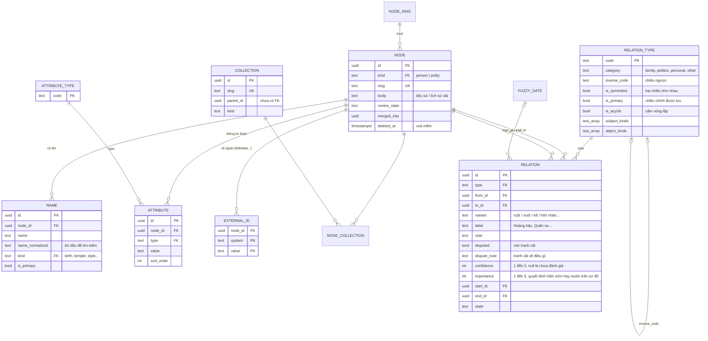
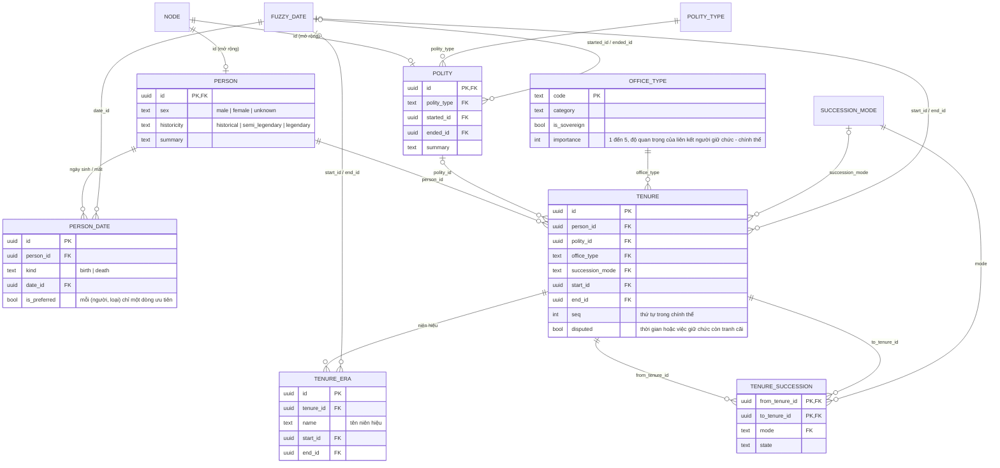
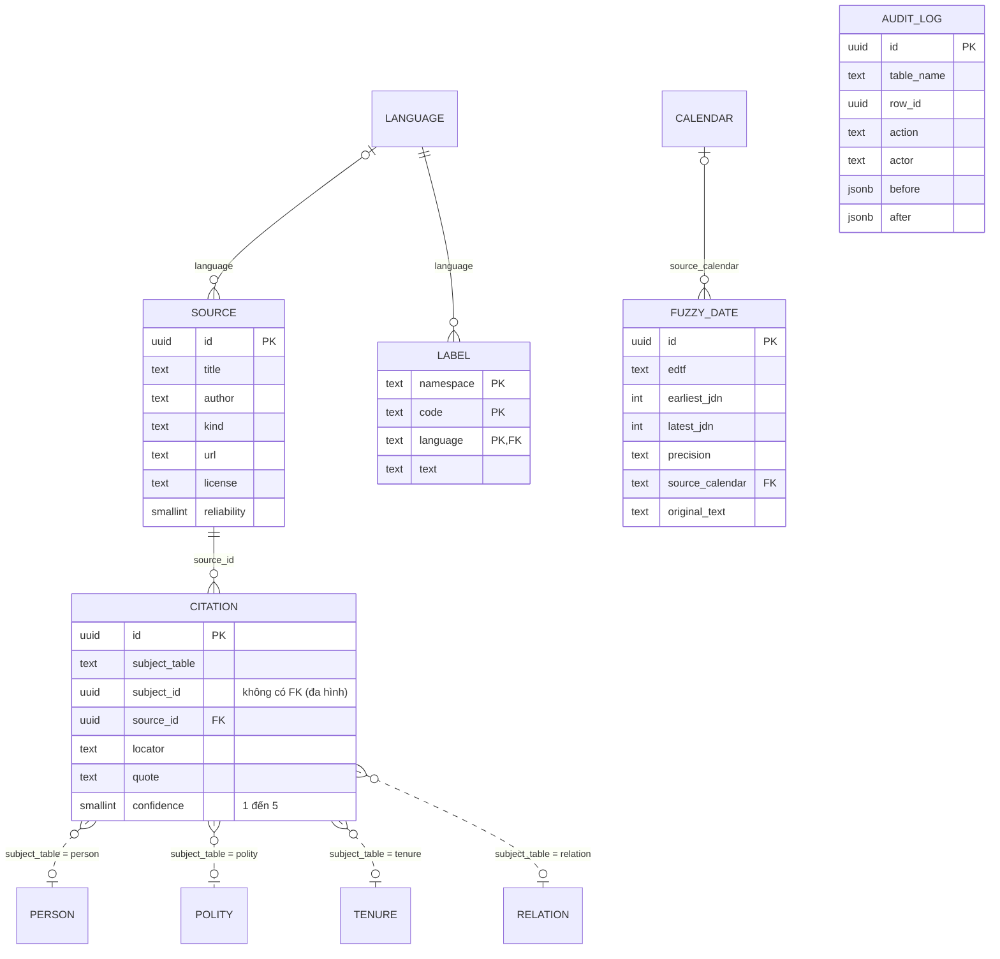
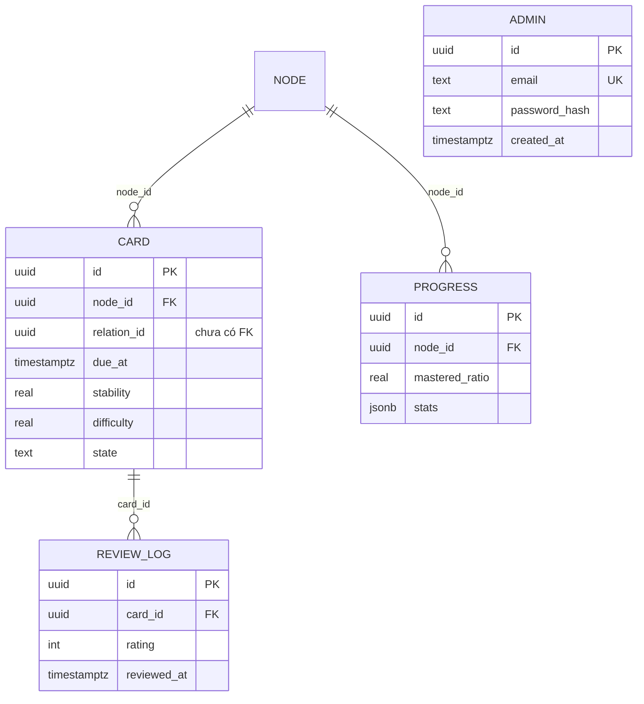

# Sơ đồ quan hệ của cơ sở dữ liệu

> Địa điểm: bảng `history.place` (phân cấp qua `parent_id`, toạ độ tuỳ chọn); nhân vật trỏ tới nó bằng `birth_place_id` và `death_place_id`. Sự kiện là một `kg.node` loại `event` kèm bảng `history.event` và `history.event_participant` (xem mục 2.1).

Nguồn sự thật là các file schema Drizzle trong `packages/core/src/schema/` (`kg.ts`, `history.ts`, `learning.ts`, `auth.ts`). File này chỉ là bản vẽ để đọc nhanh; khi đổi schema, hãy cập nhật lại cho khớp.

Postgres chia làm bốn schema:

| Schema     | Vai trò                                                                                                          |
| ---------- | ---------------------------------------------------------------------------------------------------------------- |
| `kg`       | Lớp nền dùng chung: nút (nhân vật, chính thể), tên, ngày mờ, nguồn, trích dẫn, **quan hệ**, thuộc tính, danh mục |
| `history`  | Lớp miền lịch sử: hồ sơ nhân vật, hồ sơ chính thể, chức vụ (nhiệm kỳ)                                            |
| `learning` | Lớp học: thẻ ôn tập, nhật ký, tiến độ. Chỉ tham chiếu `kg.node`                                                  |
| `auth`     | Tài khoản admin                                                                                                  |

Ghi chú đọc sơ đồ: `||--o{` là một-nhiều; `}o--o|` là nhiều-một tuỳ chọn. Mermaid hiển thị được trên GitHub và trong nhiều trình xem Markdown.

## 1. Lõi: nút và quan hệ

Đây là phần quan trọng nhất. Mọi nhân vật và chính thể đều là một `kg.node`; mọi quan hệ giữa chúng (cha mẹ–con, vợ chồng, thầy trò, đồng minh, kế vị, sáng lập…) là một dòng `kg.relation`.

Quy ước của `kg.relation`:

- Mỗi cặp loại quan hệ thuận/nghịch (ví dụ `parent_of` / `child_of`) chỉ lưu **một chiều chính** (`is_primary`). Chiều ngược được suy ra khi đọc.
- Loại đối xứng (`spouse_of`, `friend_of`, `ally_of`) lưu một lần, nút có id nhỏ hơn đứng trước.
- Loại có `is_acyclic` (cha mẹ–con) được kiểm tra vòng lặp bằng recursive CTE trước khi ghi.
- `CHECK (from_id <> to_id)`: không nối một nút với chính nó.
- `importance` (1 đến 5, `CHECK`): độ quan trọng riêng của từng quan hệ. Sơ đồ mở ra chỉ với các liên kết mức 5 (kế vị, sáng lập, chức vụ đứng đầu); bấm "Tải thêm" hạ ngưỡng từng bậc. Liên kết chức vụ lấy mức từ `history.office_type.importance` (Hoàng đế/Vua/Công/Chúa là 5, Nhiếp chính và Tể tướng là 3, còn lại 2).
- `kg.relation_type.default_importance`: điểm khởi đầu của quan hệ **mới** thuộc loại đó (kế vị, sáng lập 5; chinh phục, tách ra 4; cha mẹ-con, vợ chồng, anh em, chư hầu, đồng minh 3; thầy trò, bạn bè, đối thủ 2). Chỉ là giá trị mặc định lúc tạo: mỗi quan hệ vẫn lưu điểm riêng, đổi điểm mặc định không động tới quan hệ đã có.
- Unique index `relation_unique_key` (loại, hai đầu, biến thể) chặn trùng lặp; `kg.name` chỉ có một tên chính mỗi nút (kiểm tra ở `validation.ts`); `kg.citation` không lặp (nút, nguồn, vị trí trong nguồn).
- `kg.name.name_normalized` có chỉ mục GIN trigram (`pg_trgm`) cho tìm kiếm theo chuỗi con; chữ không phải Latin được chuyển tự (`transliteration`) khi chuẩn hoá.
- Ngày (`kg.fuzzy_date`): năm theo cách sử học (1 TCN là -1, không có năm 0), `earliest_jdn`/`latest_jdn` là số ngày Julius để sắp xếp, `edtf` có hậu tố `j` cho lịch Julius và `~` cho ngày xấp xỉ.
- Mọi thao tác ghi của admin được ghi vào `kg.audit_log` (ai, bảng nào, dòng nào, nội dung gửi lên).
- Nhãn tiếng Việt của loại quan hệ nằm trong `kg.label`, không nằm trong `relation_type`.

## 2. Lớp miền lịch sử

`history.person` và `history.polity` là **bảng mở rộng của `kg.node`**: dùng chung khoá chính (`id` vừa là PK vừa là FK sang `kg.node`).

Cả hai FK `start_id` / `end_id` của `tenure` trỏ về `kg.fuzzy_date` (ngày mờ lưu dạng EDTF kèm khoảng JDN).

`tenure` còn có `confidence` (1 đến 5, null là chưa đánh giá), `note` và `state` (`accepted` hoặc
`alternative`). Phiên bản `alternative` ghi lại cách hiểu của một sử gia khác cho cùng một ngôi vị;
sơ đồ, danh sách chính thể dùng `accepted` và kiểm tra chồng lấn bỏ qua `alternative`.

### 2.1. Sự kiện

`history.event` (1-1 với `kg.node.kind = 'event'`, nên có tên, slug, nguồn, nhật ký như nhân vật):
`event_type` (danh mục `history.event_type`), `start_id`, `end_id` (ngày mờ), `place_id`,
`parent_event_id` (chiến dịch chứa trận đánh), `summary`, `outcome`. Văn bản dài nằm ở `kg.node.body`.

`history.event_participant` (`event_id`, `node_id`, `role`, `side`, `note`, `sort_order`): người hoặc
chính thể tham gia với vai trò thuộc danh mục `history.participant_role`. `side` gom các bên của
một cuộc chiến hay hiệp ước (1, 2...). Khoá duy nhất `(event_id, node_id, role)`; ghi lại danh sách
dùng upsert chứ không xoá rồi chèn, vì hai việc đó chạy chung một câu SQL nên không có thứ tự cố định.
Sự kiện chưa là nút trong đồ thị quan hệ (đồ thị chỉ có nhân vật và chính thể); xem sự kiện của một
nút bằng `GET /events?node=<id>`.

## 3. Nguồn, trích dẫn, ngày mờ và nhật ký

`kg.citation` là **tham chiếu đa hình**: `(subject_table, subject_id)` có thể trỏ tới `person`, `polity`, `event`, `tenure` hoặc `relation`, nên không có khoá ngoại thật cho cột `subject_id`. Cột `stance` (`supports`, `disputes`, `mentions`) cho biết nguồn ủng hộ, phản bác hay chỉ nhắc đến điều được nêu, để một quan hệ còn tranh cãi trỏ được tới nguồn của từng phía.

`kg.label` giữ nhãn hiển thị (tiếng Việt) cho mọi bảng danh mục, theo khoá `(namespace, code, language)`. `kg.audit_log` ghi lịch sử thay đổi, không có khoá ngoại.

## 4. Lớp học và tài khoản

`auth.admin` hoàn toàn độc lập, không liên kết với bảng nào khác.

## 5. Các bảng danh mục

Những bảng chỉ có cột `code` (và vài cột phụ) dùng làm khoá ngoại để giới hạn giá trị; thêm giá trị mới là thêm dòng dữ liệu, không sửa code. Nhãn tiếng Việt nằm trong `kg.label`.

| Bảng                         | Dùng bởi                              | Admin sửa được             |
| ---------------------------- | ------------------------------------- | -------------------------- |
| `kg.node_kind`               | `kg.node.kind`                        | Không                      |
| `kg.name_kind`               | `kg.name.kind`                        | Có                         |
| `kg.language`, `kg.calendar` | tên, nguồn, ngày                      | Không                      |
| `kg.relation_type`           | `kg.relation.type`                    | Có, ở trang "Loại quan hệ" |
| `kg.attribute_type`          | `kg.attribute.type`                   | Có                         |
| `history.polity_type`        | `history.polity`                      | Có                         |
| `history.office_type`        | `history.tenure`                      | Có                         |
| `history.succession_mode`    | `history.tenure`, `tenure_succession` | Có                         |
| `history.event_type`         | `history.event`                       | Có                         |
| `history.participant_role`   | `history.event_participant`           | Có                         |

## 6. Những chỗ chưa có khoá ngoại

Đã biết và chưa xử lý (đang chờ quyết định, xem phần cải tiến DB ở docs khác):

- `kg.collection.parent_id`
- `kg.node.merged_into`
- `kg.name.valid_from`, `kg.name.valid_to` (lẽ ra trỏ `kg.fuzzy_date`)
- `learning.card.relation_id` (lẽ ra trỏ `kg.relation`)
- `kg.citation.subject_id` (đa hình, cố ý không có FK)
